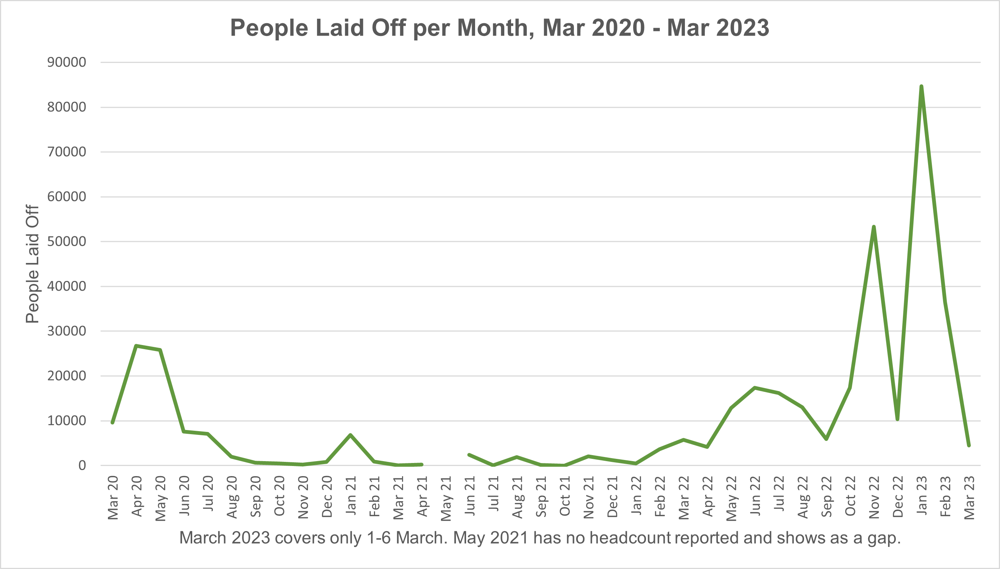
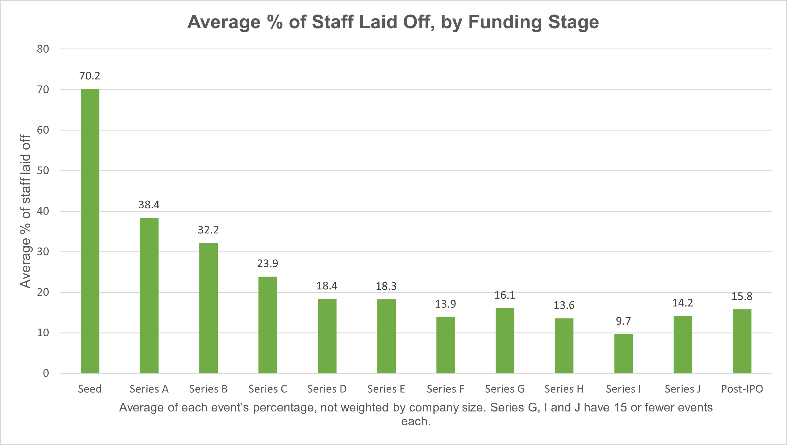
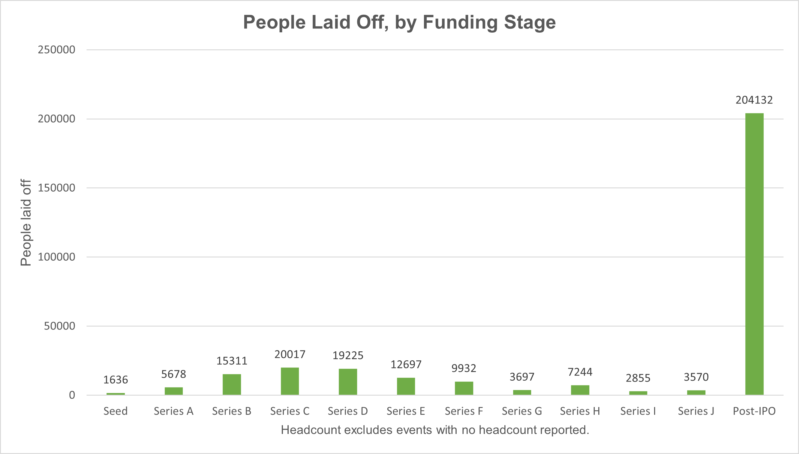
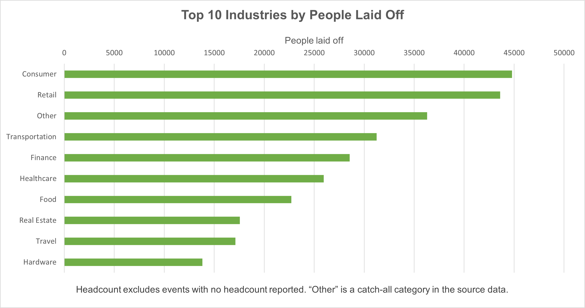

# Tech Layoffs 2020-2023: Data Cleaning & Exploratory Analysis

A SQL Server cleaning pipeline and Excel analysis of 2,361 company layoff events reported between **March 2020 and March 2023**. The raw file was typed in by hand and full of small errors, so most of this project is about finding those problems, fixing them with a documented and repeatable script, and only then charting what the data says. Completed **October 2026**.

**The short version:** 2022 was the worst year for layoffs, young startups lost the biggest *share* of their staff, and big public companies lost the most *people*.

---

## Problems in the Raw Data

The file looked fine at first glance, but charting it as-is would have produced wrong numbers. Every issue below was found by querying the data, not assumed:

| Problem in the raw file | Fix |
|---|---|
| 5 rows were exact duplicates | Removed the extra copies with `ROW_NUMBER()` over every column |
| The same event was entered twice for 3 companies (Bybit, Terminus, Oda) | Reviewed all 8 same-company, same-date pairs. Removed 4 rows where one row was empty or details conflicted. Kept the other 5 pairs, because their numbers or cities differ |
| Blank values were imported as the *word* "NULL" (737 in headcount, 782 in percentage, 208 in funding, 6 in stage, 4 in industry) | Converted to real empty values, after allowing NULLs in the `stage` and `date` columns |
| Every column was stored as text, so nothing could be summed or averaged | Changed headcount to `INT`, percentage and funding to `FLOAT` |
| "Crypto", "Crypto Currency" and "CryptoCurrency" counted as three industries | Merged into `Crypto` (3 rows) |
| "Fin-Tech" and "Finance" | Merged into `Finance` (3 rows, a judgment call) |
| "United States." with a trailing period split the US into two groups | Fixed (4 rows) |
| Dates were stored as month/day/year text | Checked every value was readable, rewrote as `yyyy-mm-dd`, converted to a real `DATE` |
| 359 rows have neither a headcount nor a percentage, 378 only a percentage, 423 only a headcount | Left empty on purpose. No values were estimated, and headcount totals are a minimum, not the true total |

The full log (issue, rows affected, fix and reason) is in the **Cleaning Log** sheet of `layoff_eda.xlsx`. Row count through the process: **2,361 → 2,356 → 2,352**.

---

## From Raw Data to Findings

### SQL Server Cleaning Script
<!-- TODO: add a screenshot of 01_cleaning.sql in SSMS with the final-check results -->

### Excel Findings Sheet
<!-- TODO: add a screenshot of the Findings sheet -->

### Charts
| Layoffs by month | Share of staff cut, by funding stage |
|---|---|
|  |  |

| People laid off, by funding stage | Top 10 industries by people laid off |
|---|---|
|  |  |

---

## Overview

The project is organized in three layers:

1. **`layoffs.csv`** — the raw layer. One row per layoff event: company, location, industry, total laid off, percentage laid off, date, funding stage, country and funds raised (millions USD). Never edited. It is loaded into SQL Server as `dbo.layoffs` and left untouched.
2. **`01_cleaning.sql`** — the cleaning and analysis layer. Rebuilds a working copy of the table (`dbo.layoffs_staging`) every time it runs, applies every fix above in order, prints a check after each step, and ends with the analysis queries that feed the charts.
3. **`layoff_eda.xlsx`** — the reporting layer. One sheet per question (`Yearly`, `Monthly`, `Stage`, `Industry`, `Shutdowns`), plus a `Findings` summary sheet with the main charts and a `Cleaning Log` sheet.

The dataset covers **11 March 2020 to 6 March 2023**: **2,352 events** and **383,000+ people laid off** (headcount reported for 1,615 of them) after cleaning.

---

## How It Works

**Cleaning (SQL Server):**
The script is designed to be re-run from the top. Each step prints an expected row count or check, so a mistake is visible immediately. Two examples:

```sql
-- Remove exact duplicates (rows identical in every column)
WITH dup_cte AS (
    SELECT *,
           ROW_NUMBER() OVER (
               PARTITION BY company, location, industry, total_laid_off,
                            percentage_laid_off, date, stage, country,
                            funds_raised_millions
               ORDER BY (SELECT NULL)
           ) AS row_num
    FROM dbo.layoffs_staging
)
DELETE FROM dup_cte
WHERE row_num > 1;

-- Turn the word 'NULL' (text) into real empty values
UPDATE dbo.layoffs_staging
SET total_laid_off      = NULLIF(total_laid_off, 'NULL'),
    percentage_laid_off = NULLIF(percentage_laid_off, 'NULL');
```

**Rules used for the same-event pairs:**
A row was removed only when it could be justified from the data itself: it was identical, it was completely empty while the other row had data, or it described the same headcount with conflicting details. If two rows had different real numbers or different cities, both were kept.

**Analysis (SQL → Excel):**
Each chart comes from one query. The result is copied into its own sheet, so every chart can be traced back to a query:

| Sheet | Question | Measures |
|---|---|---|
| `Yearly` | How many people were laid off each year? | Events, people laid off |
| `Monthly` | When were the worst months? | Events, people laid off (a real date column drives the timeline) |
| `Stage` | Who gets hit hardest: by share, and by headcount? | Events, people, average % cut, shutdowns |
| `Industry` | Which industries lost the most people? | Events, people, average % cut |
| `Shutdowns` | Did funding protect companies that shut down? | Top 10 funding totals among 100% cuts |

---

## Key Findings

| # | Finding |
|---|---|
| 1 | **2022 was the peak year:** about 160,500 people across 1,207 events. 2021 was quiet (44 events). 2023 had already reached about 125,700 people by 6 March |
| 2 | **Two big months:** November 2022 (about 53,300 people) and January 2023 (about 84,700, the biggest month in the data) |
| 3 | **Younger companies cut a bigger share of staff:** Seed-stage events averaged a 70.2% cut, against 15.8% for Post-IPO companies |
| 4 | **Big companies cut the most people:** Post-IPO companies account for about 204,100 people, roughly half of all headcount in the file, because they have far more employees |
| 5 | **Industries:** Consumer, Retail and Other lost the most people. Finance had the most events (287) but ranked fifth by people, which means many smaller layoffs |
| 6 | **Funding did not guarantee survival:** Britishvolt, Quibi and Katerra each cut 100% of their staff after raising between $1.6B and $2.4B |

---

## Files in This Repository

### `layoffs-analysis/`
| File | Description |
|------|-------------|
| `layoffs.csv` | Raw layoff data, never edited |
| `01_cleaning.sql` | Cleaning steps with built-in checks, plus the analysis queries |
| `layoff_eda.xlsx` | Findings, Cleaning Log and one sheet per analysis with charts |

---

## Example — Top 5 Industries by People Laid Off

| Industry | Events | People laid off | Avg % cut |
|---|---|---|---|
| Consumer | 116 | 44,782 | 26.5 |
| Retail | 194 | 43,613 | 26.9 |
| Other | 129 | 36,289 | 22.2 |
| Transportation | 147 | 31,248 | 25.3 |
| Finance | 287 | 28,559 | 24.5 |

---

## A Note on the Data

- This shows **what happened and when**, not **why**. Any explanation (interest rates, over-hiring) would be an outside hypothesis, not a finding from this data.
- The file only includes layoffs that were publicly reported.
- 737 events have no headcount, so people totals are a minimum, not the true total.
- 2023 covers about two months, so it can't be fairly compared with a full year.
- "Average % cut" is an average of each event's percentage, not weighted by company size.
- A 100% cut usually means a shutdown but can also mean a single unit or office closed.
- Small groups (for example Series G, I and J) are too small to read much into.
- The dataset was downloaded from a public GitHub repository of practice datasets. I did not verify where the figures originally came from, so treat them as "as reported in this file".

---

## Tools Used

- **SQL Server (SSMS)** — data cleaning, deduplication with window functions (`ROW_NUMBER`), type conversion, and aggregate analysis queries
- **Microsoft Excel** — charts, summary sheets and the cleaning log

---

## About

Built by **John Martin S. Villena**, BS Information Technology graduate (Business Analytics) from Bulacan State University.

🔗 [LinkedIn](https://www.linkedin.com/in/jhnmrtnvlln/)
💻 [GitHub](https://github.com/jhnmrtnvlln)

